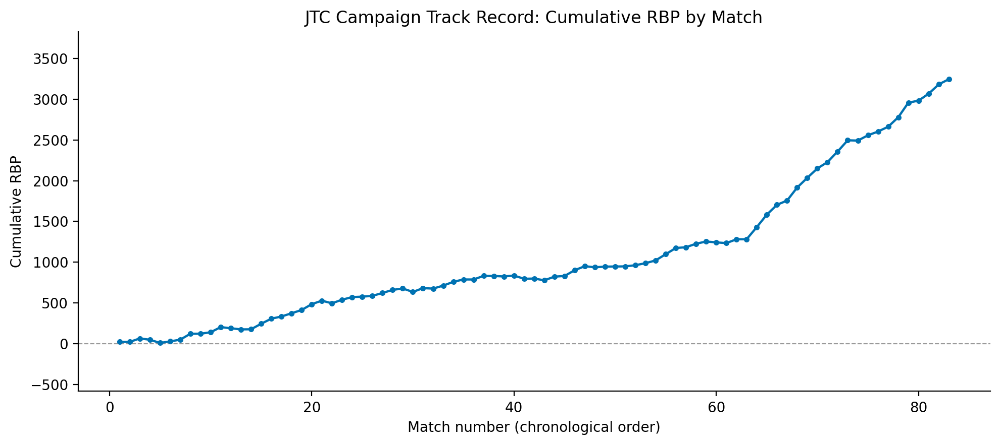

# JTC World Cup Forecasting

Models and tools for pricing the questions of a 2026 FIFA World Cup forecasting competition. Point-in-time Elo ratings, Dixon-Coles goal models, an ordered-logit outcome model and count-statistic pricing.

[](https://github.com/SouparneyaC/jtc-world-cup-forecasting/actions/workflows/ci.yml)
[](LICENSE)




Cumulative Relative Brier Points over the first 83 matches, as of 2026-07-11.

## Overview

The Jump Probability Cup is a forecasting tournament on [SportsPredict](https://play.sportspredict.com). Each World Cup match opens about fifteen questions, such as who wins, whether both teams score, how many corners there are and whether a named player has a shot on target. Entrants submit a probability for each, and the platform scores it against the crowd's consensus on the same question in Relative Brier Points.

This repository holds the pricing models, the results and the paper from one entry.

- Probabilities for results, goals, shots, corners and cards
- Ratings with no lookahead
- A written record of which tests the models passed and failed

Currently supported features:
- Point-in-time Elo ratings from a match history
- Poisson regression of goals on the Elo difference
- Dixon-Coles scoreline grid, with a Negative-Binomial option
- Ordered-logit model of win, draw and loss
- Thresholds, totals and head-to-head pricing for counts
- Brier score and the crowd-compression fit
- Question-level results tables, group stage to semifinals

## Results

The figures below are from the paper, dated 2026-07-15, and cover the matches settled through the semifinal.

| | |
|---|---|
| Matches settled | 90 |
| Questions scored | 993 |
| Cumulative RBP | about +3,905 |
| Questions where the forecast beat the crowd | 70.5% |
| Leaderboard rank on 2026-07-10 | 43 of 3,879 (top 1.11%) |

The platform's standings kept changing after those dates, and the paper does not report a final rank. The crowd's probabilities are a shrunken copy of ours (`crowd = 0.504 + 0.61 * (mine - 0.5)`, r = 0.83 over 844 questions), so a 90% estimate meets a crowd average of about 75%. [docs/methodology.md](docs/methodology.md) has the fit, how to reproduce it and what the tests found, including the learned models that did not hold up.

## Installation & Usage

Tested on Python 3.12. Needs Python 3.11 or later.

```bash
git clone https://github.com/SouparneyaC/jtc-world-cup-forecasting.git
cd jtc-world-cup-forecasting
python3 -m venv venv
venv/bin/pip install -e ".[dev]"
venv/bin/pytest
```

Price a match from expected goals (illustrative inputs):

```python
from jtc_forecast.goals import scoreline_grid, match_result_probs, btts_prob

grid = scoreline_grid(1.1, 0.8, rho=-0.06)
match_result_probs(grid)   # home_win 0.415, draw 0.329, away_win 0.256
btts_prob(grid)            # 0.375
```

Build the Elo panel from the [international results file](https://github.com/martj42/international_results):

```bash
venv/bin/python scripts/build_elo_panel.py results.csv --out-dir out/
```

Reproduce the crowd-compression fit from the committed results:

```bash
venv/bin/python scripts/reproduce_crowd_compression.py
```

Where the data comes from, and what is not redistributed, is in [docs/data-sources.md](docs/data-sources.md).

## Project Structure

```
├── src/jtc_forecast/
│   ├── ratings.py      # Point-in-time Elo ratings
│   ├── glm.py          # Poisson regression of goals on the Elo difference
│   ├── goals.py        # Dixon-Coles scoreline grid and the markets read from it
│   ├── outcome.py      # Ordered-logit model of win, draw and loss
│   ├── counts.py       # Thresholds, totals and head-to-head for counts
│   └── scoring.py      # Brier score and the crowd-compression fit
├── scripts/            # Elo panel builder, crowd-compression reproduction
├── tests/              # Unit tests on simulated data and on the results table
├── results/            # Question-level estimates, crowd probabilities and outcomes
├── data/               # Elo K-factor table
├── paper/              # The research paper and its bibliography
└── docs/               # Architecture, methodology, data sources, decision records
```

## Notes

- A question is routed by type. Where an exchange quote answers it, the quote is used. Where only team-level rates can be recovered, Poisson and Skellam arithmetic prices it. Otherwise the models here price it. [docs/architecture.md](docs/architecture.md) follows one match through the pipeline.
- A liquid market takes priority over a model by default. On 505 matches, the match-result models lost to bookmaker odds (mean Brier 0.582 against 0.567), which is why ([decision 0001](docs/decisions/0001-market-priority-over-domain-model.md)).
- The package holds the core models. The fetchers, the per-match scripts, the hand-built situational rules and the hierarchical shots and corners models are not part of it.
- The competition and the platform are not affiliated with this project. The paper is in [paper/](paper/).

## Contributing

Bug reports and small pull requests are welcome. [CONTRIBUTING.md](CONTRIBUTING.md) has the setup and the checks, and [SECURITY.md](SECURITY.md) says how to report a vulnerability.

## Credits

Built by Souparneya Chakrabarti, with Claude, an AI model from Anthropic, as a coding collaborator. To cite the work, use the "Cite this repository" box on GitHub, which reads `CITATION.cff`.

## License

[MIT](LICENSE)
