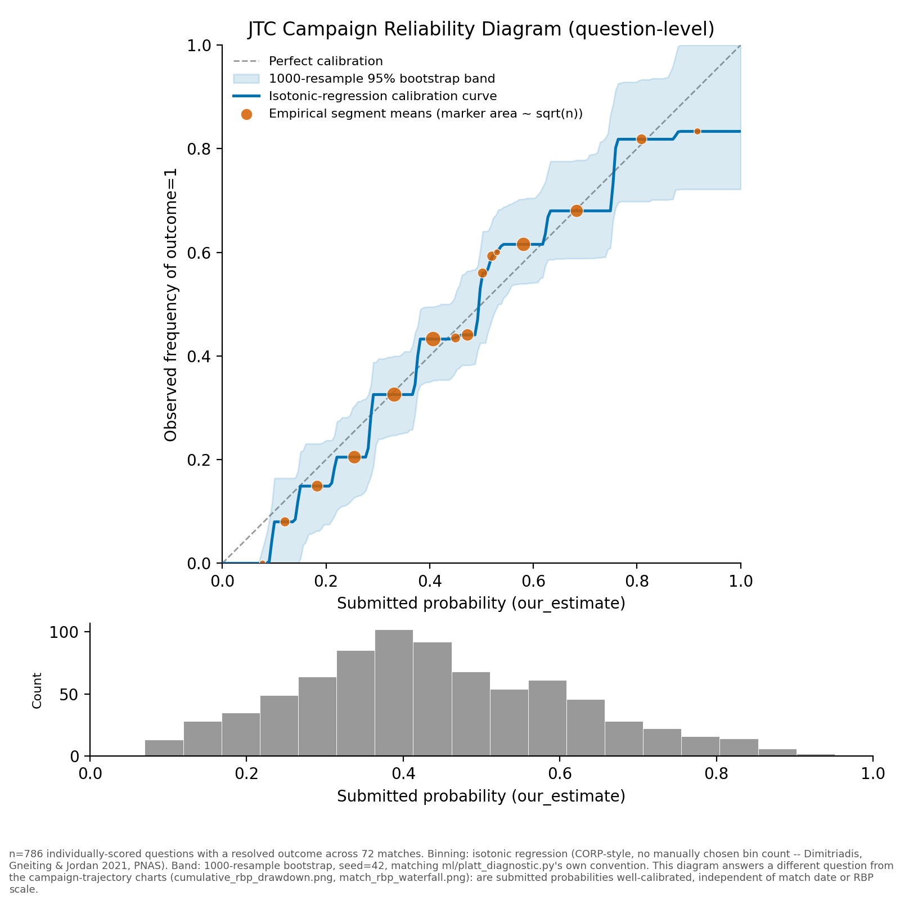

# Methodology

## Scoring

The competition scores each probability against the crowd's own consensus on the same question, in Relative Brier Points (RBP). A forecast earns points when it is closer to the outcome than the crowd's number and loses points when it is further. The platform does not publish the exact formula, and this repository reports RBP as the platform recorded it. Brier score (squared error against a 0 or 1 outcome) is a proper scoring rule, so the best strategy is to report an honest probability.

## Models

| Model | Module | Reference |
|---|---|---|
| Point-in-time Elo, K by tournament, goal-difference multiplier, 100-point home bonus | `ratings` | World Football Elo formula |
| Poisson regression of goals on the Elo difference, recency-weighted | `glm` | Hvattum and Arntzen (2010) |
| Scoreline grid with a Dixon-Coles low-score correction, optional Negative-Binomial marginals | `goals` | Dixon and Coles (1997); Karlis and Ntzoufras (2003) |
| Ordered logit on win, draw and loss | `outcome` | Hvattum and Arntzen (2010) |
| Count thresholds, totals and Skellam comparisons | `counts` | Skellam (1946) |

Validation is time-ordered (expanding window, walk-forward), never random k-fold, because match outcomes are ordered in time and a random split would leak the future into training.

## Market priority

A backtest of the match-result models against bookmaker odds on 505 historical matches found that the models lose to the market by a small but real margin (mean Brier 0.582 against 0.567, paired t-test p = 0.021). The standing rule that followed is to price at or near a liquid market and let the model nudge it (`docs/decisions/0001-market-priority-over-domain-model.md`).

## The crowd is compressed toward 50%

Across the campaign, the crowd's probability is a shrunken copy of ours:

    crowd = 0.504 + 0.61 * (mine - 0.5)

fit on 844 questions (r = 0.83, 95% confidence interval on the slope 0.58 to 0.63). At a 90% estimate the fit gives a crowd average of about 75%. The slope was 0.60 on the first 384 questions and 0.61 on the first 772, so it did not move as the sample grew. The paper names this the largest source of the campaign's positive RBP.

To reproduce the fit from the committed table:

    python scripts/reproduce_crowd_compression.py

The table covers the group stage through the round of 16 (792 usable questions, slope 0.605, intercept 0.503, r 0.827). The paper's figure adds the quarterfinals and semifinals.

Reliability diagram for 786 resolved questions across 72 matches, from early July. Points near the diagonal mean the submitted probabilities matched how often the outcomes happened.

Two cautions from the paper. In an early 85-question window the crowd's raw Brier score beat the models', and the beat-crowd rate was 52.9%. The edge comes from winning by large margins on the questions where the crowd is most wrong, so it is a high-variance strategy.

## Learned models did not hold up

Four tests asked whether a learned model of our estimate and the crowd's should replace the hand-built pipeline:

1. A Platt-scaling recalibration. The bootstrap interval on the slope includes 1.0, and the slope was unstable out of sample (0.196 against 0.510 in sample).
2. A 19-feature logistic regression and a gradient-boosting blend, under walk-forward and grouped cross-validation. Both lost to trusting the crowd under both schemes.
3. A linear regression of RBP on distance from the crowd. In-sample R squared was 0.053, and it lost to a naive baseline out of sample.
4. A closed-form result: with an additive, strictly proper scoring rule, pushing a forecast a distance d past a calibrated estimate costs d squared with no offsetting gain.

With about 1,000 scored questions, any model with many features sits well below the usual guidance of 10 to 20 events per fitted parameter. Every submitted probability came from the hand-built pipeline.

## Pre-registered tests by question family

For hierarchical models on shots on target, corners, cards, offsides and first-substitution timing, the hypothesis, the validation method and the pass bar were written before fitting. Two families passed (shots on target, corners) and three failed (cards, offsides, first substitution). The failures are kept in the record.

## Limits

- One tournament and about 1,000 scored questions.
- The leaderboard rank in the paper (43 of 3,879, top 1.11%) is a snapshot from 2026-07-10, before the final. Totals in the paper stop at the semifinal.
- 12 round-of-32 matches have no settlement data in the master dataset, so cumulative figures from that dataset undercount.
- The service reads questions and submits probabilities. It has no order path.
